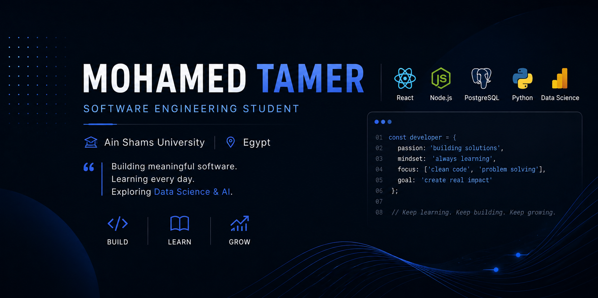

  

<h1 align="center">Hi, I'm Mohamed Tamer 👋</h1>

  AI Engineering Student @ Ain Shams University 🇪🇬

  Building meaningful software • Learning every day • Exploring Data Science & AI

---

## About Me

I've always been curious about how technology turns simple ideas into products that people use every day. That curiosity is what led me to software engineering, and it's what continues to drive me today.

I don't see software engineering as something I study only at university. To me, it's a mindset built around continuous learning, constant improvement, and never settling for "good enough."

Every project I build teaches me something new. Every bug I solve helps me think differently. Every challenge pushes me to become a better engineer than I was yesterday, and that's the part of this journey I enjoy the most.

The more I learn, the more I realize how much there is still to discover—and that's exactly what keeps me motivated. I enjoy understanding how systems work behind the scenes, improving the way I solve problems, and turning ideas into useful, reliable software.

I'm also beginning to explore Data Science and Artificial Intelligence. I'm interested in how data can be transformed into insights, predictions, and intelligent solutions, and I'm looking forward to developing deeper knowledge in this field throughout my academic journey.

I'm not chasing titles or shortcuts. I'm chasing growth, meaningful experiences, and the opportunity to build technology that creates real value.

---

## What I'm Focused On Right Now

- 🚀 Building projects that challenge me and help me grow
- 📚 Learning something new every day
- 🧩 Strengthening my problem-solving mindset
- ⚙️ Writing cleaner and more maintainable software
- 📊 Expanding my knowledge in Data Science & Artificial Intelligence

---

## Selected Projects

- 🎓 **University Management System**  
  A full-stack platform designed to support students, instructors, and university administration.

- 🧠 **Compiler Project**  
  A scanner and parser for the TINY programming language, built using C# and Windows Forms.

- ⚙️ **Embedded Systems Projects**  
  Hands-on projects involving UART, ADC, timers, LCDs, keypads, and the TM4C123 microcontroller.

---

## Technologies I've Worked With

  

---

## A Personal Philosophy

> **Success isn't about knowing everything. It's about never stopping the journey of learning.**

---

## Let's Connect

If you're passionate about technology, continuous learning, or building impactful software, I'd be happy to connect, share ideas, and learn from your journey too.

  
  

